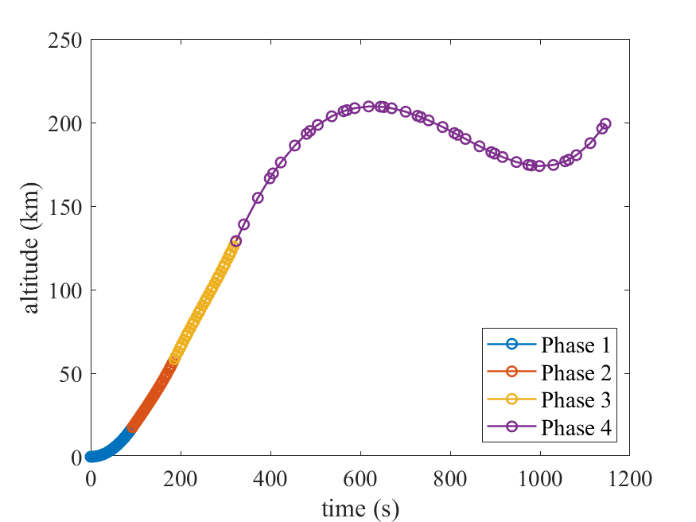
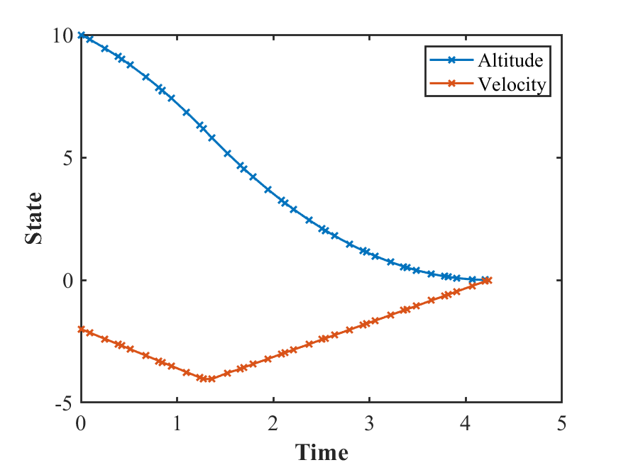

# Control_Engineer

现代控制、估计与优化算法的 MATLAB / Simulink 实现合集，覆盖从经典观测器到最优控制的常用方法，每个目录对应一类算法，可独立运行。

A collection of control, estimation and optimization algorithms implemented in MATLAB / Simulink.

## 目录

| 目录 | 内容 | 形式 |
| :-- | :-- | :-- |
| [`ADRC/`](ADRC) | 自抗扰控制：跟踪微分器（TD）、扩张状态观测器（ESO）与控制律 | Simulink |
| [`Adaptive/`](Adaptive) | 自适应控制、自适应反步控制 | Simulink |
| [`backstepping/`](backstepping) | 二阶系统反步法控制 | Simulink |
| [`HOSM/`](HOSM) | 高阶滑模微分器 | Simulink |
| [`FOSM/`](FOSM) | 分数阶滑模、分数阶快速终端滑模控制 | Simulink |
| [`FO/`](FO) | 分数阶微积分数值计算（Grünwald–Letnikov 定义）与分数阶系统仿真 | MATLAB |
| [`MPC/`](MPC) | 线性模型预测控制：预测矩阵构造与滚动优化 | MATLAB |
| [`GPM/`](GPM) | 高斯伪谱法求解最优控制问题，含 GPOPS-II 算例：运载火箭上升段、月球软着陆、航天器姿态机动、车辆转向与制动 | MATLAB |
| [`Ballastic_design/`](Ballastic_design) | 带落角与飞行时间约束的最优弹道设计 | MATLAB |
| [`Parameter_Identification/`](Parameter_Identification) | 参数辨识与状态估计：最小二乘、递推最小二乘（RLS）、卡尔曼滤波（KF）、扩展卡尔曼滤波（EKF） | MATLAB |
| [`matlab_optimal/`](matlab_optimal) | 粒子群优化（PSO） | MATLAB |
| [`Optimizer/`](Optimizer) | 模拟退火求解旅行商问题（TSP） | MATLAB |
| [`linear_state_observer.slx`](linear_state_observer.slx) | 线性状态观测器 | Simulink |

## 运行环境

- MATLAB + Simulink（`.slx` 模型建议使用 R2020b 及以上版本打开）
- `GPM/` 中的 GPOPS-II 算例需要另行安装 [GPOPS-II](https://www.gpops2.com/) 与 SNOPT / IPOPT 求解器

## 使用方法

```matlab
% 脚本类算法：进入对应目录后直接运行
cd MPC
mpc_test1

% Simulink 模型：如目录下有初始化脚本，先运行再打开模型
cd ADRC
ini
open_system('ADRC.slx')
```

## 部分结果

高斯伪谱法求解的运载火箭上升段与月球软着陆问题：

| 运载火箭上升段高度 | 月球软着陆状态 |
| :-: | :-: |
|  |  |
